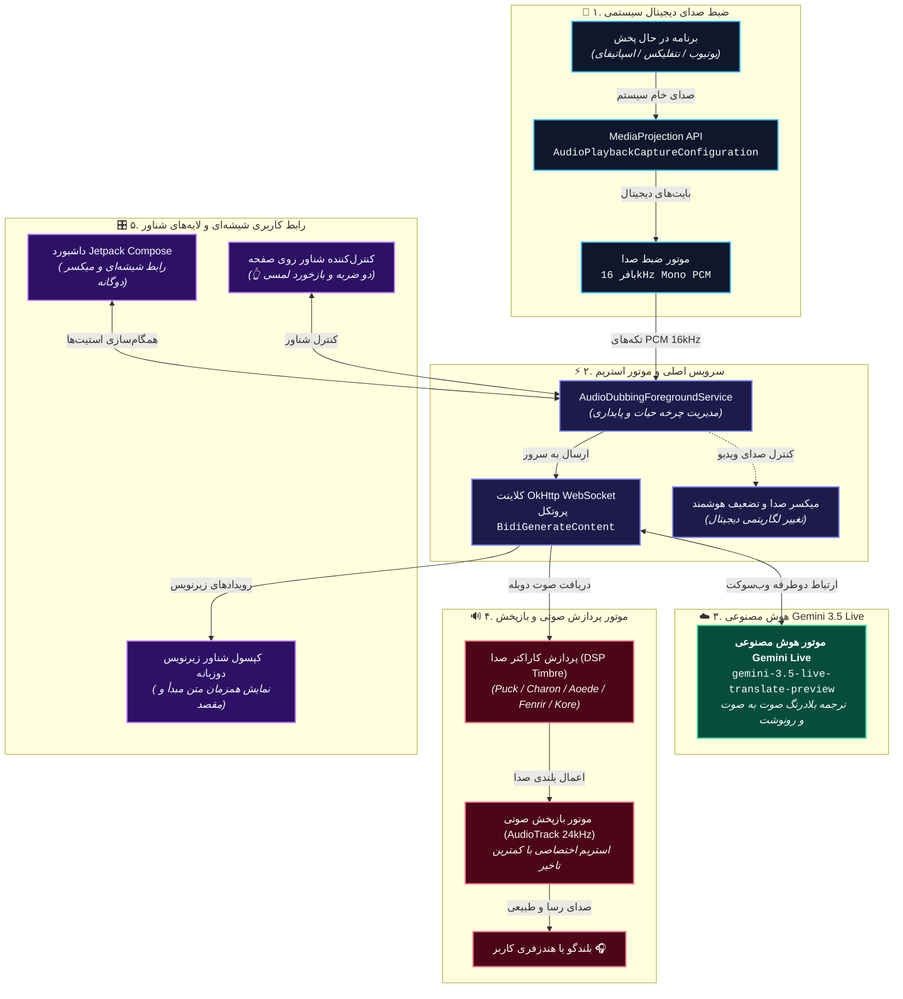

<div align="center">
  <a href="README.md">Read in English</a> | 🌐 <strong>خواندن به زبان فارسی</strong>
</div>

<div align="center">
  

<h1>🎙️ ALAD — دوبله زنده صوتی با هوش مصنوعی (موبایل)</h1>

<p><strong>دوبله همزمان و زیرنویس دوزبانه زنده برای تمامی اپلیکیشن‌های اندروید، با قدرت Gemini 3.5 Live Translate گوگل.</strong></p>

<p>
  <a href="https://github.com/navidseyedain/ALAD-Mobile/stargazers"></a>
  <a href="https://github.com/navidseyedain/ALAD-Mobile/releases/latest"></a>
  <a href="https://developer.android.com/"></a>
  <a href="https://kotlinlang.org/"></a>
  <a href="https://aistudio.google.com/"></a>
  <a href="https://github.com/navidseyedain/ALAD-Mobile?tab=readme-ov-file#%EF%B8%8F-%D9%BE%D8%B4%D8%AA%DB%8C%D8%A8%D8%A7%D9%86%DB%8C-%D8%A7%D8%B2-%DB%B7%DB%B8-%D8%B2%D8%A8%D8%A7%D9%86"></a>
  <a href="LICENSE"></a>
</p>

<p>
  <b>هر ویدیوی خارجی را تماشا کنید یا به پادکست‌ها گوش دهید؛ همزمان ترجمه صوتی و زیرنویس آن را به زبان مادری خود بشنوید و بخوانید!</b><br/>
  بدون نیاز به اشتراک • بدون نیاز به ثبت‌نام در سایت‌های واسط • کاملاً رایگان و متن‌باز
</p>

<a href="https://github.com/navidseyedain/ALAD-Mobile/releases/latest"></a>

<br/>

</div>

---

## 🌍 معرفی برنامه ALAD Mobile

برنامه **ALAD (AI Live Audio Dubbing)** یک اپلیکیشن کاملاً بومی اندروید است که مرزهای زبان را در دستگاه‌های هوشمند جابه‌جا می‌کند. این برنامه در پس‌زمینه دستگاه اجرا شده و جریان صدای دیجیتال داخلی هر برنامه‌ای (یوتیوب، نتفلیکس، اسپاتیفای، پادکست‌ها، توییچ و...) را مستقیماً دریافت کرده و از طریق اتصال فوق‌سریع وب‌سوکت برای هوش مصنوعی پیشرفته **Gemini 3.5 Live Translate** گوگل ارسال می‌کند. صدای ترجمه‌شده با کلامی طبیعی، زنده و بدون مکث بازپخش می‌شود و همزمان متن دوزبانه آن نیز به نمایش درمی‌آید.

برخلاف برنامه‌های زیرنویس سنتی که باید چشمتان به صفحه قفل باشد، با ALAD **به محتوا گوش می‌دهید** و از تماشای روان ویدیو لذت می‌برید.

> **کاربردهای اصلی:**
> - 🎬 **فیلم و سریال:** فیلم‌های کره‌ای، ژاپنی، اسپانیایی، ترکی یا فرانسوی را تماشا کنید و دوبله زنده فارسی را بشنوید.
> - 🎙️ **پادکست‌ها و مصاحبه‌ها:** مصاحبه‌های روز دنیا را در حال رانندگی یا پیاده‌روی به زبان مادری گوش دهید.
> - 🎓 **دوره‌های آموزشی و دانشگاهی:** بدون افتادن در دام لغات دشوار تخصصی، جدیدترین آموزش‌ها را متوجه شوید.
> - 🎮 **پخش زنده و استریم:** استریم‌های زنده یوتیوب و توییچ را همگام با گوینده درک کنید.

---

## 📸 تصاویر محیط برنامه (تست‌شده روی دستگاه واقعی)

<div align="center">
  <table>
    <tr>
      <td align="center" width="33%">
        <br/>
        <b>🏠 داشبورد شیشه‌ای مدرن</b><br/>
        <sub>طراحی یکدست تیره با میکسر صدای دوگانه و انتخابگر زبان با پرچم بومی</sub>
      </td>
      <td align="center" width="33%">
        <br/>
        <b>🔴 امواج زنده و زیرنویس همزمان</b><br/>
        <sub>موج صوتی نئونی روان با کپسول نمایش رونوشت زنده گفتار و ترجمه</sub>
      </td>
      <td align="center" width="33%">
        <br/>
        <b>🌍 لهجه‌ها و گویش‌های منطقه‌ای</b><br/>
        <sub>پشتیبانی از لهجه‌های بومی با اصطلاحات محلی (مصری، خلیجی، شامی و...)</sub>
      </td>
    </tr>
    <tr>
      <td align="center" width="33%">
        <br/>
        <b>🎬 کنترل شناور روی ویدیوها</b><br/>
        <sub>ویجت قابل جابه‌جایی به همراه کپسول شیشه‌ای زیرنویس همزمان روی یوتیوب</sub>
      </td>
      <td align="center" width="33%">
        <br/>
        <b>🎙️ ۵ کاراکتر صوتی و حالات دوبله</b><br/>
        <sub>تغییر لحن و کاراکتر صدا، ۳ حالت دوبله و تنظیمات زیرنویس دوزبانه</sub>
      </td>
      <td align="center" width="33%">
        <br/>
        <b>💡 راهنمای شروع سریع</b><br/>
        <sub>راهنمای قدم‌به‌قدم راه‌اندازی و رفع خطای نصب در رابط کاربری One UI سامسونگ</sub>
      </td>
    </tr>
  </table>
</div>

<br/>

### 🎥 ویدیوی دموی عملکرد برنامه

<div align="center">
  <!-- 🎥 ویدیوی دمو: لینک ویدیوی آپلود شده را جایگزین کنید -->
  <video src="https://github.com/user-attachments/assets/54efbdc7-e19f-49ac-9afd-aafa0d73650a" controls="controls" width="360" poster="docs/4.jpg">
    <p>ویدیوی دموی عملکرد برنامه در این بخش قرار دارد. با دانلود فایل نصبی می‌توانید دوبله زنده را خودتان تجربه کنید.</p>
  </video>
  <br/>
  <p><sub>💡 <i>دموی ویدیویی از دوبله همزمان ویدیوی انگلیسی یوتیوب به فارسی به صورت بلادرنگ توسط ALAD</i></sub></p>
</div>

---

## 🌟 امکانات و تغییرات جدید نسخه v1.3.0

نسخه **v1.3.0** یک به‌روزرسانی بزرگ و بنیادین در کیفیت صدا، انعطاف‌پذیری و زیبایی بصری است:

| امکان جدید | توضیحات و کارکرد |
|---|---|
| 🎚️ **میکسر صدای دوگانه مستقل** | اسلایدرهای تفکیک‌شده (۰ تا ۱۰۰ درصد) و کلیدهای قطع صدای آنی برای **صدای دوبله هوش مصنوعی** و **صدای اصلی ویدیو** با مقیاس‌بندی لگاریتمی دیجیتال. |
| 🎙️ **۵ کاراکتر صوتی هوش مصنوعی** | انتخاب لحن گوینده جمینای: **Puck** (پرانرژی و رسا)، **Charon** (بم و عمیق)، **Aoede** (آرام و ملایم)، **Fenrir** (رسمی و قاطع) و **Kore** (لطیف و دلنشین) با فیلتر بلادرنگ آکوستیک. |
| 🌍 **لهجه‌ها و گویش‌های منطقه‌ای** | ترجمه طبیعی به گویش‌های محلی واقعی شامل عربی (*مصری، خلیجی، شامی، مراکشی، الجزایری*)، اسپانیایی (*آمریکای لاتین، مکزیکی، آرژانتینی*)، انگلیسی (*آمریکایی، بریتانیایی، استرالیایی*) و فارسی (*معیار تهرانی، دری افغانستان، تاجیکی*). |
| 💬 **زیرنویس دوزبانه زنده شناور** | نمایش همزمان متن گفتار خارجی و ترجمه فارسی در یک پنجره شیشه‌ای متحرک روی تمام اپلیکیشن‌ها. |
| 🔀 **۳ حالت دوبله مجزا** | **صدا + زیرنویس (ترکیبی)**، **فقط دوبله صوتی** (برای گوش دادن در پس‌زمینه) و **فقط زیرنویس زنده** (حالت بی‌صدا برای محیط‌های ساکت). |
| 🎨 **رابط کاربری شیشه‌ای آبگون** | پس‌زمینه مشکی ابریشمی با خطوط الماسی، موج صوتی یکپارچه بدون لکه‌های اضافه و سازگاری کامل با چیدمان راست‌به‌چپ (RTL). |
| ⚡ **معماری بدون وقفه (Zero-Interruption)** | استقلال کامل تنظیمات؛ کم و زیاد کردن صدا یا تغییر گوینده بدون هیچ‌گونه قطعی یا ریست در اتصال زنده جمینای صورت می‌گیرد. |

---

## ✨ ویژگی‌های برجسته فنی

### 🎙️ ۱. دوبله زنده با کمترین تاخیر زمانی (Ultra-Low Latency)
- **استریم دوطرفه بلادرنگ:** اتصال بدون وقفه وب‌سوکت با پروتکل `BidiGenerateContent` جمینای لایو برای دریافت سریع تکه‌های صوتی PCM.
- **ضبط صدای دیجیتال سیستمی:** استفاده مستقیم از `MediaProjection API` اندروید بدون افت کیفیت و بدون دریافت نویز محیط یا میکروفون.
- **کاهش هوشمند صدای پس‌زمینه (Smart Audio Ducking):** همگام با شروع صحبت هوش مصنوعی، صدای رسانه به صورت نرم تضعیف شده و پس از پایان جمله مجدداً به سطح اولیه بازمی‌گردد.
- **سرویس پایدار پیش‌زمینه:** پایداری کامل فرآیند دوبله هنگام بستن پنجره اصلی برنامه یا کار با سایر اپلیکیشن‌ها.

### 🎛️ ۲. ویجت کنترل و زیرنویس شناور روی صفحه
- **کنترل سریع در هر محیط:** مدیریت دوبله بدون نیاز به ترک ویدیوی در حال پخش یا بازی.
- **👆 فرمان سریع با دو بار ضربه (Double-Tap):** دو بار لمس سریع ویجت شناور برای توقف و ادامه لحظه‌ای دوبله.
- **کپسول شیشه‌ای زیرنویس دوزبانه:** نمایش همزمان گفتار زبان مبدأ و ترجمه روان مقصد در بستری شفاف و مدرن.

### 📳 ۳. بازخورد لمسی فیزیکی (Haptic Feedback)
- **حس لمس دکمه‌های واقعی:** با فشردن کلیدهای سه‌بعدی و کنترل‌های شناور، لرزش‌های ظریف و لذت‌بخشی زیر انگشتان خود حس می‌کنید.

---

## 🗺️ پشتیبانی از ۷۸ زبان

<details>
<summary><b>برای مشاهده لیست کامل ۷۸ زبان کلیک کنید</b></summary>

<br/>

| | | | |
|---|---|---|---|
| 🇿🇦 آفریکانس (Afrikaans) | 🇪🇹 امهری (Amharic) | 🇸🇦 عربی (Arabic) | 🇦🇲 ارمنی (Armenian) |
| 🇦🇿 آذربایجانی (Azerbaijani) | 🇧🇩 بنگالی (Bengali) | 🇧🇬 بلغاری (Bulgarian) | 🇲🇲 برمه‌ای (Burmese) |
| 🇨🇳 چینی ساده (Chinese) | 🇹🇼 چینی سنتی (Taiwan) | 🇭🇷 کرواتی (Croatian) | 🇨🇿 چکی (Czech) |
| 🇩🇰 دانمارکی (Danish) | 🇳🇱 هلندی (Dutch) | 🇺🇸 انگلیسی (English) | 🇪🇪 استونیایی (Estonian) |
| 🇵🇭 فیلیپینی (Filipino) | 🇫🇮 فنلاندی (Finnish) | 🇫🇷 فرانسوی (French) | 🇬🇪 گرجی (Georgian) |
| 🇩🇪 آلمانی (German) | 🇬🇷 یونانی (Greek) | 🇮🇳 گجراتی (Gujarati) | 🇳🇬 هائوسا (Hausa) |
| 🇮🇱 عبری (Hebrew) | 🇮🇳 هندی (Hindi) | 🇭🇺 مجاری (Hungarian) | 🇮🇸 ایسلندی (Icelandic) |
| 🇮🇩 اندونزیایی (Indonesian) | 🇮🇹 ایتالیایی (Italian) | 🇯🇵 ژاپنی (Japanese) | 🇮🇳 کانادایی (Kannada) |
| 🇰🇿 قزاقی (Kazakh) | 🇰🇭 خمر (Khmer) | 🇷🇼 کینیارواندایی | 🇰🇷 کره‌ای (Korean) |
| 🇱🇦 لائوسی (Lao) | 🇱🇻 لتونیایی (Latvian) | 🇱🇹 لیتوانیایی (Lithuanian) | 🇲🇰 مقدونی (Macedonian) |
| 🇲🇾 مالایی (Malay) | 🇮🇳 مالایالم (Malayalam) | 🇮🇳 مراتی (Marathi) | 🇲🇳 مغولی (Mongolian) |
| 🇳🇵 نپالی (Nepali) | 🇳🇴 نروژی (Norwegian) | 🇮🇷 **فارسی (Persian)** | 🇵🇱 لهستانی (Polish) |
| 🇧🇷 پرتغالی برزیل | 🇵🇹 پرتغالی پرتغال | 🇮🇳 پنجابی (Punjabi) | 🇷🇴 رومانیایی (Romanian) |
| 🇷🇺 روسی (Russian) | 🇷🇸 صربی (Serbian) | 🇮🇳 سندی (Sindhi) | 🇱🇰 سینهالی (Sinhala) |
| 🇸🇰 اسلواکی (Slovak) | 🇸🇮 اسلوونیایی (Slovenian) | 🇪🇸 اسپانیایی (Spanish) | 🇰🇪 سواحیلی (Swahili) |
| 🇸🇪 سوئدی (Swedish) | 🇮🇳 تامیلی (Tamil) | 🇮🇳 تلوگو (Telugu) | 🇹🇭 تایلندی (Thai) |
| 🇹🇷 ترکی استانبولی | 🇺🇦 اوکراینی (Ukrainian) | 🇵🇰 اردو (Urdu) | 🇺🇿 ازبکی (Uzbek) |
| 🇻🇳 ویتنامی (Vietnamese) | 🇿🇦 زولو (Zulu) | | |

</details>

---

## 🚀 راهنمای نصب و شروع به کار

### پیش‌نیازها
1. **دستگاه اندروید:** نسخه اندروید 10.0 (API 29) به بالا (برای ضبط مستقیم صدای سیستمی لازم است).
2. **کلید رایگان Gemini API:** دریافت رایگان از [Google AI Studio](https://aistudio.google.com/).

### نصب سریع برنامه
1. به صفحه [Releases گیت‌هاب](https://github.com/navidseyedain/ALAD-Mobile/releases/latest) بروید.
2. فایل **`ALAD-v1.3.0.apk`** را دانلود نمایید.
3. برنامه را روی گوشی خود نصب و اجرا کنید.
4. روی آیکون ⚙️ **تنظیمات** بزنید، کلید API خود را وارد کرده و صدای هوش مصنوعی مدنظر را انتخاب نمایید.
5. زبان و لهجه را در صفحه اصلی انتخاب کرده و روی **شروع دوبله** کلیک کنید!

### ساخت از روی کد منبع (Build from Source)
```bash
# دریافت مخزن
git clone https://github.com/navidseyedain/ALAD-Mobile.git
cd ALAD-Mobile

# کامپایل و خروجی APK
./gradlew assembleDebug
```

---

## 🧠 معماری و ساختار فنی سیستم



---

## 🔧 راهنمای عیب‌یابی و حل مشکلات احتمالی

| مشکل | علت احتمالی | راه‌حل |
|---|---|---|
| **صدایی بعد از شروع شنیده نمی‌شود** | ویدیوی اصلی پخش نمی‌شود یا سهمیه کلید API تمام شده است | مطمئن شوید ویدیو در برنامه پس‌زمینه در حال پخش است و وضعیت کلید API را بررسی کنید. |
| **خطای "اتصال وب‌سوکت برقرار نشد"** | کلید API نادرست است یا اینترنت فیلتر/محدود است | کلید API را در تنظیمات مجدداً وارد کنید و وضعیت اتصال اینترنت / فیلترشکن را بررسی کنید. |
| **قطع شدن دوبله در هنگام جابه‌جایی بین برنامه‌ها** | مدیریت باتری اندروید سرویس را متوقف کرده است | به مسیر *اطلاعات برنامه (App Info) > باتری (Battery)* بروید و آن را روی حالت *نامحدود (Unrestricted)* بگذارید. |
| **صدای برخی برنامه‌ها ضبط نمی‌شود** | محدودیت امنیتی برنامه مقصد (DRM یا تماس تلفنی) | طبق سیاست‌های امنیتی اندروید، ضبط صدای تماس‌های تلفنی و محتوای دارای قفل DRM (مانند استریم محافظت‌شده نتفلیکس) مسدود است. |
| **خطای عدم نصب در گوشی‌های سامسونگ (One UI 6+)** | قابلیت امنیتی Auto Blocker مانع نصب برنامه‌های ناشناس می‌شود | قابلیت *Auto Blocker* را به طور موقت در بخش *تنظیمات > امنیت و حریم خصوصی* خاموش کرده یا فایل را از طریق برنامه فایل‌ها (My Files) نصب کنید. |

---

## 🗺️ نقشه راه توسعه (Roadmap)

- [x] **نسخه ۱.۰.۰:** انتشار اولیه عمومی (پشتیبانی از Gemini Live و ۷۸ زبان)
- [x] **نسخه ۱.۱.۰:** بازطراحی کامل شیشه‌ای، بازخورد لمسی (Haptic) و کنترل سریع دو ضربه ویجت
- [x] **نسخه ۱.۲.۰:** انتخاب ۵ کاراکتر صوتی هوش مصنوعی و کپسول شناور زیرنویس زنده
- [x] **نسخه ۱.۳.۰:** میکسر دوگانه مستقل صدا با اسلایدرهای تفکیک‌شده و کلیدهای قطع صدای آنی
- [x] **نسخه ۱.۳.۰:** پشتیبانی از لهجه‌ها و گویش‌های منطقه‌ای بومی (عربی، اسپانیایی، انگلیسی، فارسی)
- [x] **نسخه ۱.۳.۰:** زیرنویس دوزبانه همزمان (متن گفتار اصلی انگلیسی + ترجمه فارسی)
- [x] **نسخه ۱.۳.۰:** معماری بدون وقفه، حذف نقاط اضافه امواج و پولیش بصری Liquid Glass
- [ ] **نسخه ۱.۴.۰:** تشخیص کاملاً خودکار زبان گفتار مبدأ
- [ ] **نسخه ۱.۵.۰:** پشتیبانی از میکروفون هندزفری بلوتوث جهت دوبله گفتگوهای زنده محیطی

---

## 📜 مجوز (License)

این پروژه تحت مجوز **MIT License** منتشر شده است. برای اطلاعات بیشتر فایل [`LICENSE`](LICENSE) را مطالعه کنید.

---

## 🙏 قدردانی

- با تشکر ویژه از تیم **Google DeepMind** برای معماری انقلابی Gemini Live.
- با تشکر از پلتفرم **Google AI Studio** برای ارائه دسترسی رایگان به کلیدهای API.

<div align="center">
  <sub>ساخته‌شده با ❤️ توسط <a href="https://github.com/navidseyedain">نوید سیدین</a>. اگر ALAD برای شما مفید بود، لطفاً با ثبت یک ⭐ در گیت‌هاب از پروژه حمایت کنید!</sub>
</div>
