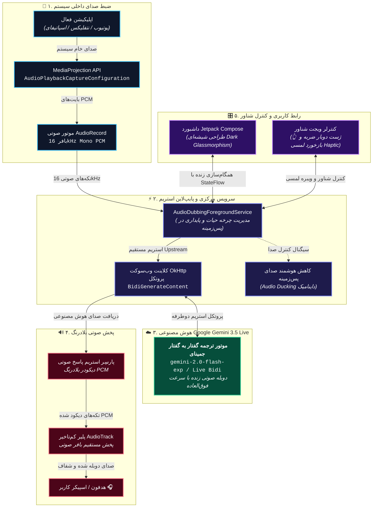

<div align="center">
  <a href="README.md">Read in English</a> | 🌐 <strong>خواندن به زبان فارسی</strong>
</div>

<div align="center">
  

<h1>🎙️ ALAD — دوبله زنده صوتی با هوش مصنوعی (نسخه موبایل)</h1>

<p><strong>دوبله همزمان و زنده برای تمام اپلیکیشن‌های اندروید، با قدرت گرفتن از مدل Gemini 3.5 Live Translate گوگل.</strong></p>

<p>
  <a href="https://github.com/navidseyedain/ALAD-Mobile/stargazers"></a>
  <a href="https://github.com/navidseyedain/ALAD-Mobile/releases/latest"></a>
  <a href="https://developer.android.com/"></a>
  <a href="https://kotlinlang.org/"></a>
  <a href="https://aistudio.google.com/"></a>
  <a href="https://github.com/navidseyedain/ALAD-Mobile/blob/main/README-fa.md#%EF%B8%8F-پشتیبانی-از-۷۸-زبان"></a>
  <a href="LICENSE"></a>
</p>

<p>
  <b>هر ویدیوی خارجی را تماشا کنید یا به هر پادکستی گوش دهید؛ بلافاصله آن را به زبان مادری خود بشنوید.</b><br/>
  بدون نیاز به اشتراک • بدون نیاز به ساخت حساب کاربری • ۱۰۰٪ رایگان و متن‌باز
</p>

<a href="https://github.com/navidseyedain/ALAD-Mobile/releases/latest"></a>

<br/>

</div>

---

## 🌍 اپلیکیشن ALAD Mobile چیست؟

**الاد (AI Live Audio Dubbing)** یک اپلیکیشن بومی اندروید است که مرزهای زبان را در تلفن‌های هوشمند از بین می‌برد. این برنامه به صورت کاملاً بی‌صدا و پایدار در پس‌زمینه اجرا می‌شود؛ صدای داخلی خروجی از هر اپلیکیشن در حال اجرا (مثل یوتیوب، نتفلیکس، اسپاتیفای، پادکست‌ها، توییچ و...) را ضبط کرده، آن را از طریق اتصال پرسرعت وب‌سوکت به پیشرفته‌ترین مدل هوش مصنوعی **Gemini 3.5 Live Translate** گوگل می‌فرستد و صدای دوبله‌شده‌ی روان را در همان لحظه با کمترین تاخیر برای شما پخش می‌کند.

برخلاف ابزارهای سنتی زیرنویس، الاد یک **دوبله صوتی و کلامی زنده** ارائه می‌دهد — یعنی نیازی نیست چشم به صفحه بدوزید و متن بخوانید، بلکه مستقیماً ترجمه را *می‌شنوید*.

> **کاربردهای روزمره:**
> - 🎬 **تماشای فیلم و سریال:** فیلم‌های کره‌ای، ژاپنی، اسپانیایی یا انگلیسی را بدون زیرنویس تماشا کنید و دوبله زنده فارسی بشنوید.
> - 🎙️ **پادکست‌ها و مصاحبه‌ها:** به جدیدترین پادکست‌های علمی و خبری دنیا گوش دهید در حالی که همزمان به زبان دلخواهتان دوبله می‌شوند.
> - 🎓 **دوره‌های آموزشی و دانشگاهی:** ویدیوهای یوتیوب و آموزش‌های تخصصی را به راحتی متوجه شوید.
> - 🎮 **لایو استریم‌ها:** مکالمات استریمرهای مطرح خارجی در توییچ و یوتیوب را به صورت زنده درک کنید.

---

## 📸 گالری تصاویر و دموی زنده

<div align="center">
  <table>
    <tr>
      <td align="center" width="33%">
        <br/>
        <b>🏠 رابط کاربری مدرن شیشه‌ای</b>
      </td>
      <td align="center" width="33%">
        <br/>
        <b>🔴 ویژوالایزر امواج صوتی نئونی</b>
      </td>
      <td align="center" width="33%">
        <br/>
        <b>🌐 پشتیبانی از ۷۸ زبان با پرچم</b>
      </td>
    </tr>
    <tr>
      <td align="center" width="33%">
        <br/>
        <b>🎛️ کنترل شناور روی یوتیوب و ویدیوها</b>
      </td>
      <td align="center" width="33%">
        <br/>
        <b>⚙️ تنظیم امن کلید Gemini API</b>
      </td>
      <td align="center" width="33%">
        <br/>
        <b>💡 راهنمای قدم‌به‌قدم و سریع</b>
      </td>
    </tr>
  </table>
</div>

<br/>

### 🎥 ویدیوی دموی عملکرد برنامه

<div align="center">
  <video src="https://github.com/user-attachments/assets/54efbdc7-e19f-49ac-9afd-aafa0d73650a" controls="controls" width="360">
    مرورگر شما از پخش ویدیو پشتیبانی نمی‌کند.
  </video>
</div>

---

## ✨ ویژگی‌های برجسته برنامه

### 🎙️ ۱. دوبله زنده صوتی با کمترین تاخیر (Ultra-Low Latency)
- **استریم دوطرفه بلادرنگ:** برقراری اتصال مستقیم WebSocket با موتور Gemini Live برای تبدیل گفتار به گفتار در لحظه.
- **ضبط صدای سیستمی شفاف:** استفاده از `MediaProjection API` بدون هیچ‌گونه افت کیفیت یا دریافت نویزهای محیطی اتاق و میکروفون.
- **تضعیف خودکار صدای اصلی (Smart Audio Ducking):** هنگام صحبت گوینده هوش مصنوعی، صدای پس‌زمینه برنامه (مثل ویدیوی یوتیوب) به طور خودکار کم می‌شود تا صدای ترجمه کاملاً رسا شنیده شود.
- **سرویس پایدار پس‌زمینه (Foreground Service):** تداوم فرآیند دوبله در هنگام جابه‌جایی بین اپلیکیشن‌ها یا حتی خاموش بودن صفحه نمایش.

### 🎛️ ۲. ویجت کنترل شناور هوشمند (Smart Floating Widget)
- **مولتی‌تسکینگ بدون دردسر:** فعال‌سازی و توقف دوبله بدون نیاز به خروج از بازی، فیلم یا ویدیو.
- **👆 کنترل سریع با دو بار ضربه (Double-Tap):** با دو بار لمس سریع هر کجای ویجت شناور، دوبله را درجا متوقف یا ادامه دهید.
- **هاله نوری درخشان (Pulsing Halo):** رقص نور نئونی دور ویجت که وضعیت زنده بودن دوبله را به شما نمایش می‌دهد.
- **قابلیت جابه‌جایی آسان:** امکان کشیدن و رها کردن ویجت به هر گوشه از صفحه نمایش.

### 📳 ۳. بازخورد لمسی فیزیکی (Haptic Feedback)
- **حس لمس دکمه‌های واقعی:** با هر بار فشردن دکمه استارت/استاپ یا دکمه‌های ویجت شناور، یک لرزش کوتاه و خوشایند حس می‌کنید که کار با رابط شیشه‌ای را بسیار لذت‌بخش می‌کند.

### 🎨 ۴. طراحی شیشه‌ای مدرن و آینده‌نگرانه (Dark Glassmorphism)
- **تم فضایی با نورپردازی محیطی:** ترکیب پس‌زمینه مشکی ابریشمی با هاله‌های نئونی فیروزه‌ای و بنفش.
- **کارت‌های شیشه‌ای مات (Frosted Glass):** لایه‌های نیمه‌شفاف با حاشیه‌های الماسی و افکت مات شیشه‌ای.
- **امواج صوتی واکنشی:** ویژوالایزر صوتی پویا با انیمیشن‌های فیزیکی روان متناسب با خروجی صدای دستگاه.
- **دکمه سه‌بعدی:** دکمه اکشن برجسته با فیزیک ارتجاعی و سایه‌های عمقی.

### 🎚️ ۵. میکسر صدای دوگانه مستقل (Dual Audio Mixer)
- **کنترل تفکیک‌شده صدا:** تنظیم مستقل بلندی صدای هوش مصنوعی (دوبله) و صدای ویدیوی در حال پخش با اسلایدرهای اختصاصی و کلیدهای قطع صدای آنی (Mute).
- **بازگردانی هوشمند ولوم:** حفظ و بازگرداندن خودکار بلندی صدای اولیه رسانه به هنگام خروج از برنامه یا توقف دوبله.

### 🗣️ ۶. لهجه‌ها و گویش‌های منطقه‌ای و زیرنویس دوگانه زنده
- **گویش‌های اختصاصی:** انتخاب گویش‌ها و لهجه‌های محبوب شامل عربی (مصر، خلیج، شامی)، انگلیسی (آمریکایی، بریتانیایی)، اسپانیایی (لاتین)، فارسی (معیار و دری) و غیره.
- **زیرنویس همزمان دوگانه:** مشاهده همزمان متن اصلی گفتار انگلیسی/خارجی به همراه زیرنویس ترجمه شده در کپسول سینمایی شناور.

---

## 🗺️ پشتیبانی از ۷۸ زبان

<details>
<summary><b>برای مشاهده لیست کامل ۷۸ زبان کلیک کنید</b></summary>

<br/>

| | | | |
|---|---|---|---|
| 🇿🇦 آفریکانس (Afrikaans) | 🇪🇹 امهری (Amharic) | 🇸🇦 عربی (Arabic) | 🇦🇲 ارمنی (Armenian) |
| 🇦🇿 آذربایجانی (Azerbaijani) | 🇧🇩 بنگالی (Bengali) | 🇧🇬 بلغاری (Bulgarian) | 🇲🇲 برمه‌ای (Burmese) |
| 🇨🇳 چینی ساده (Chinese) | 🇹🇼 چینی سنتی (Taiwan) | 🇭🇷 کرواتی (Croatian) | 🇨🇿 چکی (Czech) |
| 🇩🇰 دانمارکی (Danish) | 🇳🇱 هلندی (Dutch) | 🇺🇸 انگلیسی (English) | 🇪🇪 استونیایی (Estonian) |
| 🇵🇭 فیلیپینی (Filipino) | 🇫🇮 فنلاندی (Finnish) | 🇫🇷 فرانسوی (French) | 🇬🇪 گرجی (Georgian) |
| 🇩🇪 آلمانی (German) | 🇬🇷 یونانی (Greek) | 🇮🇳 گجراتی (Gujarati) | 🇳🇬 هائوسا (Hausa) |
| 🇮🇱 عبری (Hebrew) | 🇮🇳 هندی (Hindi) | 🇭🇺 مجاری (Hungarian) | 🇮🇸 ایسلندی (Icelandic) |
| 🇮🇩 اندونزیایی (Indonesian) | 🇮🇹 ایتالیایی (Italian) | 🇯🇵 ژاپنی (Japanese) | 🇮🇳 کانادایی (Kannada) |
| 🇰🇿 قزاقی (Kazakh) | 🇰🇭 خمر (Khmer) | 🇷🇼 کینیارواندایی | 🇰🇷 کره‌ای (Korean) |
| 🇱🇦 لائوسی (Lao) | 🇱🇻 لتونیایی (Latvian) | 🇱🇹 لیتوانیایی (Lithuanian) | 🇲🇰 مقدونی (Macedonian) |
| 🇲🇾 مالایی (Malay) | 🇮🇳 مالایالم (Malayalam) | 🇮🇳 مراتی (Marathi) | 🇲🇳 مغولی (Mongolian) |
| 🇳🇵 نپالی (Nepali) | 🇳🇴 نروژی (Norwegian) | 🇮🇷 **فارسی (Persian)** | 🇵🇱 لهستانی (Polish) |
| 🇧🇷 پرتغالی برزیل | 🇵🇹 پرتغالی پرتغال | 🇮🇳 پنجابی (Punjabi) | 🇷🇴 رومانیایی (Romanian) |
| 🇷🇺 روسی (Russian) | 🇷🇸 صربی (Serbian) | 🇮🇳 سندی (Sindhi) | 🇱🇰 سینهالی (Sinhala) |
| 🇸🇰 اسلواکی (Slovak) | 🇸🇮 اسلوونیایی (Slovenian) | 🇪🇸 اسپانیایی (Spanish) | 🇰🇪 سواحیلی (Swahili) |
| 🇸🇪 سوئدی (Swedish) | 🇮🇳 تامیلی (Tamil) | 🇮🇳 تلوگو (Telugu) | 🇹🇭 تایلندی (Thai) |
| 🇹🇷 ترکی استانبولی (Turkish) | 🇺🇦 اوکراینی (Ukrainian) | 🇵🇰 اردو (Urdu) | 🇺🇿 ازبکی (Uzbek) |
| 🇻🇳 ویتنامی (Vietnamese) | 🇿🇦 زولو (Zulu) | | |

</details>

---

## 🚀 راهنمای راه‌اندازی و استفاده

### پیش‌نیازها
1. **دستگاه اندرویدی:** اندروید نسخه 10.0 (API 29) یا بالاتر (جهت پشتیبانی از ضبط صدای داخلی سیستم).
2. **کلید API جمینای:** دریافت کلید رایگان از [Google AI Studio](https://aistudio.google.com/).

### نصب سریع
1. به صفحه [انتشارها (Releases)](https://github.com/navidseyedain/ALAD-Mobile/releases/latest) مراجعه کنید.
2. آخرین نسخه فایل نصبی **`ALAD-Mobile-v1.3.0.apk`** را دانلود کنید.
3. فایل را روی گوشی نصب کنید.
4. وارد برنامه شده، روی آیکون ⚙️ **تنظیمات** بزنید، کلید API خود را وارد کرده و **ذخیره** را بزنید.
5. زبان مقصد را انتخاب کنید، دکمه **شروع دوبله** را لمس کنید و از برنامه لذت ببرید!

### بیلد از روی سورس کد
```bash
# کلون کردن ریپازیتوری
git clone https://github.com/navidseyedain/ALAD-Mobile.git
cd ALAD-Mobile

# اجرای دستور ساخت نسخه نهایی
./gradlew assembleRelease
```

---

## 🧠 معماری و عملکرد برنامه (System Architecture)

اپلیکیشن ALAD از یک معماری رویداد-محور و پایپ‌لاین استریمینگ دوطرفه برای دستیابی به کمترین تاخیر زمانی (زیر ۱ ثانیه) استفاده می‌کند:



### 🧩 تشریح لایه‌ها و اجزای فنی

| لایه / ماژول | تکنولوژی | مسئولیت و قابلیت‌های کلیدی |
|---|---|---|
| **📱 ضبط صدای سیستم** | `MediaProjection API` + `AudioRecord` | ضبط صدای مستقیم دیجیتال از گوشی بدون کوچک‌ترین نویز محیطی میکروفون. |
| **🌐 ارتباط پرسرعت استریم** | `OkHttp WebSocket Client` | برقراری اتصال زنده و مستمر با پروتکل `BidiGenerateContent` هوش مصنوعی جمینای. |
| **🧠 موتور دوبله هوش مصنوعی** | `gemini-3.5-live-translate-preview` | مدل گفتار به گفتار پیشرفته Google DeepMind برای ترجمه و سنتز طبیعی صدا. |
| **🔊 پخش صوتی هوشمند** | `AudioTrack (16kHz PCM)` + `AudioManager` | پخش بلادرنگ صدا همراه با قابلیت **Audio Ducking** (کم کردن خودکار صدای فیلم اصلی). |
| **⚡ سرویس پس‌زمینه** | `LifecycleService` + `Coroutines/Flows` | تضمین اجرای پایدار در پس‌زمینه سیستم عامل و همگام‌سازی لحظه‌ای وضعیت‌ها. |
| **🎛️ ویجت کنترل شناور** | `WindowManager` + `Jetpack Compose` | ویجت همه‌کاره با هاله نوری پالس‌زننده، بازخورد لمسی **Haptic** و ژست **Double-Tap**. |
| **🎨 سیستم دیزاین** | `Jetpack Compose + Material 3` | طراحی فوق‌العاده شیشه‌ای **Dark Glassmorphism** با المان‌های سه‌بعدی. |
| **🔒 ذخیره‌سازی داده‌ها** | `Jetpack DataStore (Preferences)` | ذخیره‌سازی امن و ری‌اکتیو تنظیمات و کلید اختصاصی API. |

---

## 📁 ساختار پوشه‌های پروژه

```text
ALAD-Mobile/
├── app/src/main/
│   ├── kotlin/com/alad/app/
│   │   ├── core/
│   │   │   ├── audio/          # ماژول‌های ضبط صدا، کاهش صدا و پخش زنده
│   │   │   ├── network/        # مدیریت ارتباط استریم وب‌سوکت با جمینای
│   │   │   └── service/        # سرویس‌های پس‌زمینه و ویجت شناور
│   │   ├── data/               # ذخیره‌سازی داده‌های محلی DataStore
│   │   ├── presentation/
│   │   │   ├── main/           # صفحه اصلی برنامه و ViewModel
│   │   │   └── settings/       # صفحه تنظیمات و ViewModel
│   │   ├── ui/theme/           # سیستم طراحی شیشه‌ای، رنگ‌ها و تایپوگرافی
│   │   └── MainActivity.kt     # نقطه ورود برنامه و مدیریت دسترسی‌ها
│   └── AndroidManifest.xml     # تعاریف سرویس‌ها و مجوزهای اندروید
├── docs/                       # تصاویر باکیفیت و ویدیوی دموی برنامه
└── build.gradle.kts            # کتابخانه‌ها و تنظیمات بیلد پروژه
```

---

## 🔧 راهنمای عیب‌یابی مشکلات

| مشکل | علت احتمالی | راه‌حل |
|---|---|---|
| **هیچ صدایی بعد از شروع پخش نمی‌شود** | برنامه مورد نظر صدایی پخش نمی‌کند یا سهمیه API تمام شده است | مطمئن شوید برنامه اصلی صدا دارد و کلید API را در AI Studio چک کنید. |
| **خطای "WebSocket connection failed"** | کلید API نامعتبر است یا اینترنت قطع شده است | کلید API را در تنظیمات بازبینی کنید یا وضعیت اتصال اینترنت را چک کنید. |
| **دوبله با رفتن به برنامه‌های دیگر متوقف می‌شود** | سیستم ذخیره باتری اندروید سرویس را متوقف کرده است | به مسیر *App Info > Battery* رفته و حالت را روی **Unrestricted** قرار دهید. |
| **صدای برخی اپلیکیشن‌ها ضبط نمی‌شود** | برنامه از ضبط داخلی محافظت می‌کند (DRM یا تماس) | اندروید به دلایل امنیتی اجازه ضبط صدای تماس‌های تلفنی و محتوای دارای کپی‌رایت DRM را نمی‌دهد. |
| **خطای "برنامه نصب نشد" در سامسونگ (One UI 6+)** | بررسی امنیتی و سخت‌گیرانه قابلیت Auto Blocker | قابلیت Auto Blocker را در *Settings > Security and privacy* موقتاً غیرفعال کنید یا فایل نصبی را از طریق برنامه فایل‌های شخصی (My Files) نصب نمایید. |

---

## 🗺️ برنامه‌های آینده (Roadmap)

- [x] **v1.0.0:** انتشار اولیه (اتصال به Gemini Live و پشتیبانی از ۷۸ زبان)
- [x] **v1.1.0:** بازطراحی کامل شیشه‌ای (Dark Glassmorphism)، بازخورد لمسی (Haptic)، ژست دوبار ضربه ویجت و رفع باگ‌های وضعیت
- [x] **v1.2.0:** انتخاب صدای گوینده هوش مصنوعی (بین صداهای مختلف جمینای مثل *Puck, Aoede, Charon, Fenrir, Kore*)
- [x] **v1.2.0:** نمایش زیرنویس شناور زنده (Live Floating Subtitles)
- [x] **v1.3.0:** میکسر صدای دوگانه مستقل با اسلایدرهای اختصاصی و کلید Mute برای هوش مصنوعی و ویدیوی اصلی
- [x] **v1.3.0:** پشتیبانی از لهجه‌ها و گویش‌های منطقه‌ای (عربی، انگلیسی، اسپانیایی، فارسی دری/معیار و...)
- [x] **v1.3.0:** زیرنویس دوگانه زنده و همزمان (متن گفتار مبدأ + متن ترجمه شده)
- [x] **v1.3.0:** پایپ‌لاین فوق‌سریع پردازش صدا (تکه‌های ۴۰ میلی‌ثانیه‌ای و AudioTrack کم‌تاخیر)
- [ ] **v1.4.0:** تشخیص خودکار زبان مبدأ ویدیو
- [ ] **v1.5.0:** پشتیبانی از ورودی میکروفون هندزفری و ایرپاد بلوتوثی

---

## 🤝 مشارکت در توسعه

از هرگونه گزارش باگ، پیشنهاد امکانات یا پول ریکوئست (Pull Request) به گرمی استقبال می‌شود!

1. ریپازیتوری را Fork کنید
2. یک شاخه جدید بسازید (`git checkout -b feature/AmazingFeature`)
3. تغییرات خود را کامیت کنید (`git commit -m 'feat: Add AmazingFeature'`)
4. آن را روی شاخه خود پوش کنید (`git push origin feature/AmazingFeature`)
5. یک Pull Request ایجاد کنید

---

## 📜 لایسنس

این پروژه تحت مجوز **MIT** منتشر شده است. برای اطلاعات بیشتر فایل [`LICENSE`](LICENSE) را مطالعه فرمایید.

---

## 🙏 تشکر و قدردانی

- تیم **Google DeepMind** برای توسعه فناوری انقلابی Gemini Live.
- تیم **Google AI Studio** برای ارائه دسترسی رایگان به API.

<div align="center">
  <sub>ساخته شده با ❤️ توسط <a href="https://github.com/navidseyedain">نوید سیدین</a>. اگر الاد برای شما مفید بود، لطفاً با دادن ستاره (⭐) از پروژه حمایت کنید!</sub>
</div>
