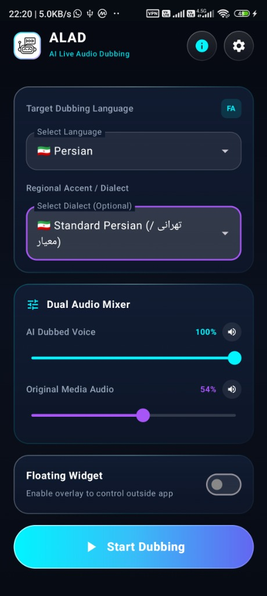
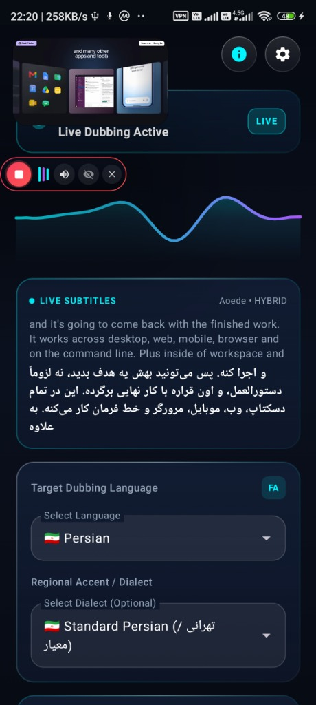
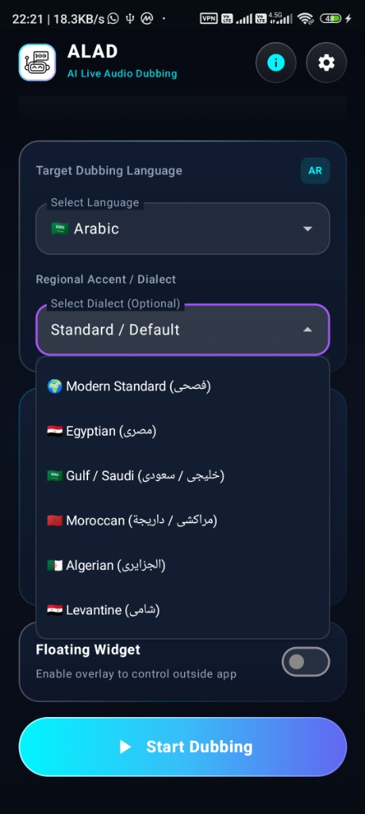
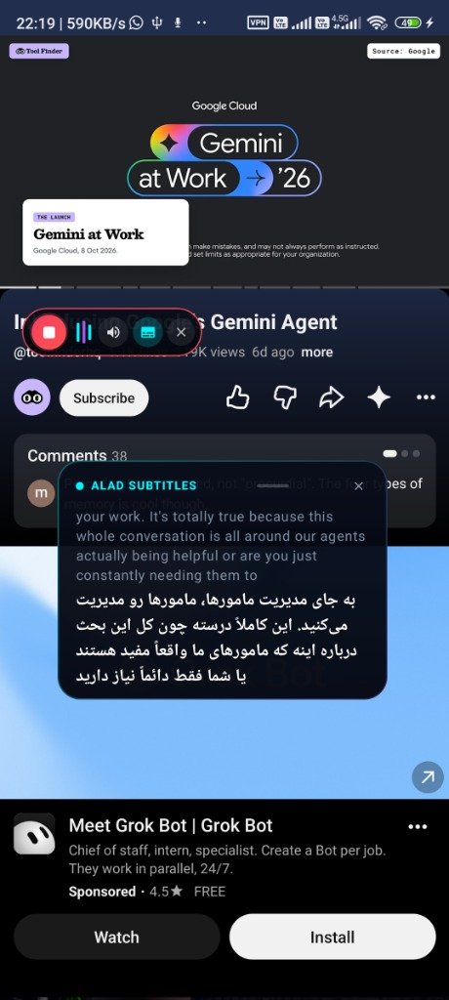
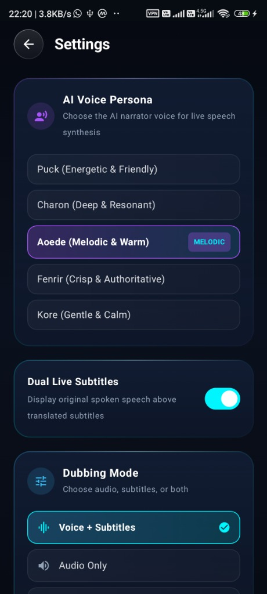
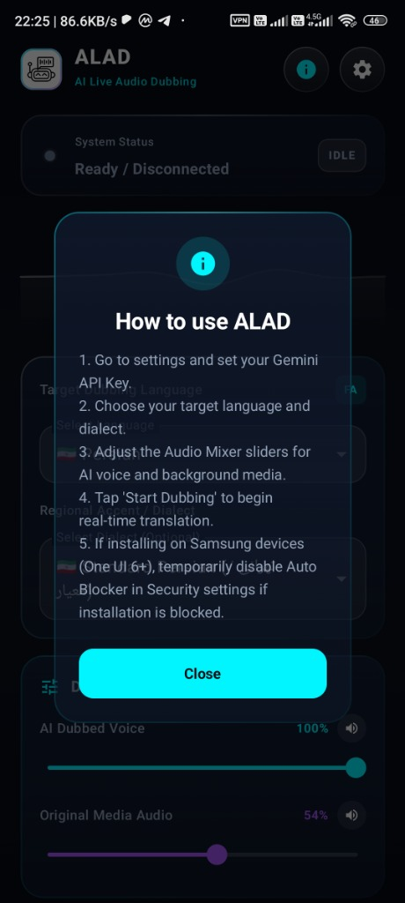
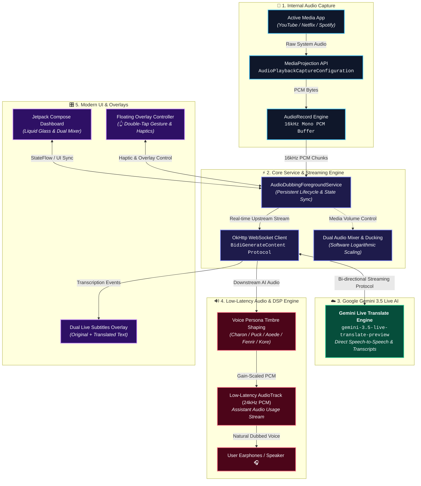

<div align="center">
  🌐 <strong>Read in English</strong> | <a href="README-fa.md">خواندن به زبان فارسی</a>
</div>

<div align="center">
  

<h1>🎙️ ALAD — AI Live Audio Dubbing (Mobile)</h1>

<p><strong>Real-time AI vocal dubbing & dual live subtitles for any Android app, powered by Google's Gemini 3.5 Live Translate.</strong></p>

<p>
  <a href="https://github.com/navidseyedain/ALAD-Mobile/stargazers"></a>
  <a href="https://github.com/navidseyedain/ALAD-Mobile/releases/latest"></a>
  <a href="https://developer.android.com/"></a>
  <a href="https://kotlinlang.org/"></a>
  <a href="https://aistudio.google.com/"></a>
  <a href="https://github.com/navidseyedain/ALAD-Mobile?tab=readme-ov-file#%EF%B8%8F-78-supported-languages"></a>
  <a href="LICENSE"></a>
</p>

<p>
  <b>Watch any foreign video or listen to any podcast. Hear and read it in your native language — instantly.</b><br/>
  No subscriptions. No third-party accounts. 100% free and open-source.
</p>

<a href="https://github.com/navidseyedain/ALAD-Mobile/releases/latest"></a>

<br/>

</div>

---

## 🌍 What is ALAD Mobile?

**ALAD (AI Live Audio Dubbing)** is a native Android application that completely eliminates language barriers on mobile devices. Working seamlessly in the background, ALAD captures internal system audio directly from any active app (YouTube, Netflix, Spotify, Podcasts, Twitch, etc.), streams it to Google's **Gemini 3.5 Live Translate** model via high-speed WebSockets, and plays back fluid, natural translated speech in real time while displaying simultaneous dual-language subtitles.

Unlike traditional subtitle apps or delayed translators, ALAD delivers **zero-lag vocal dubbing** — you *listen* to the content naturally without having to stare at the screen.

> **Key Use Cases:**
> - 🎬 **Movies & Series:** Watch foreign cinema (Korean, Japanese, Turkish, Spanish, etc.) and hear real-time spoken translation in your native language.
> - 🎙️ **Podcasts & Music:** Listen to international podcasts and interviews with live AI voice dubbing.
> - 🎓 **Online Learning & Lectures:** Follow university courses and tech tutorials without missing technical terms.
> - 🎮 **Live Streams:** Understand international Twitch and YouTube streamers live as they speak.

---

## 📸 Screenshots & Showcase

<div align="center">
  <table>
    <tr>
      <td align="center" width="33%">
        <br/>
        <b>🏠 Liquid Glass Dashboard</b><br/>
        <sub>Clean obsidian dark mode with Dual Audio Mixer & native language selector</sub>
      </td>
      <td align="center" width="33%">
        <br/>
        <b>🔴 Active Dubbing & Waveform</b><br/>
        <sub>Real-time glowing audio visualizer & live bilingual subtitle banner</sub>
      </td>
      <td align="center" width="33%">
        <br/>
        <b>🌍 Regional Dialects & Accents</b><br/>
        <sub>Native dialect support with authentic regional phrasing & local idioms</sub>
      </td>
    </tr>
    <tr>
      <td align="center" width="33%">
        <br/>
        <b>🎬 Floating Dubbing & Subtitles</b><br/>
        <sub>Draggable controller widget & translucent dual-subtitle overlay on YouTube</sub>
      </td>
      <td align="center" width="33%">
        <br/>
        <b>🎙️ 5 Voice Personas & Modes</b><br/>
        <sub>Instant timbre shaping, 3 dubbing modes, and dual-subtitle preferences</sub>
      </td>
      <td align="center" width="33%">
        <br/>
        <b>💡 Interactive Quick Guide</b><br/>
        <sub>Step-by-step setup onboarding & Samsung One UI auto-blocker tips</sub>
      </td>
    </tr>
  </table>
</div>

<br/>

### 🎥 Live Demo Video

<div align="center">
  <!-- 🎥 Video Demo: Replace the video src URL with your uploaded video asset link -->
  <video src="https://github.com/user-attachments/assets/5c649309-53c8-4f4d-b75f-5ea110d5abfe" controls="controls" width="360" poster="docs/4.jpg">
    <p>Video demo is available above. Download the APK to experience real-time AI dubbing on your phone!</p>
  </video>
  <br/>
  <p><sub>💡 <i>Watch ALAD live-dubbing an English YouTube tech keynote into Persian in real time.</i></sub></p>
</div>

---

## 🌟 What's New in v1.3.0

The **v1.3.0 release** represents a massive leap forward in audio fidelity, customizability, and visual refinement:

| Feature | Description |
|---|---|
| 🎚️ **Dual Audio Mixer** | Independent volume sliders (0–100%) and instant mute buttons for both the **AI Dubbed Voice** and the **Original Media Audio**, backed by software logarithmic PCM scaling. |
| 🎙️ **5 AI Voice Personas** | Choose your narrator's timbre: **Puck** (Energetic & Friendly), **Charon** (Deep & Resonant), **Aoede** (Melodic & Warm), **Fenrir** (Crisp & Authoritative), or **Kore** (Gentle & Calm) with real-time acoustic DSP filtering. |
| 🌍 **Regional Dialects & Accents** | Select authentic spoken dialects: Arabic (*Egyptian, Saudi/Gulf, Levantine, Moroccan, Algerian*), Spanish (*Latin American, Castilian, Mexican, Argentine*), English (*US, UK, AU, IN*), and Persian (*Standard, Dari, Tajiki*). |
| 💬 **Dual Live Subtitles** | Watch original spoken speech alongside translated subtitles in a cinematic floating glass capsule over any video player. |
| 🔀 **3 Dubbing Modes** | **Voice + Subtitles (Hybrid)**, **Audio Only** (for listening in background), or **Subtitles Only** (silent translation mode). |
| 🎨 **Refined Liquid Glass UI** | Pure obsidian theme, glowing neon gradient waveform, polished typography, and zero background clutter. |
| ⚡ **Zero-Interruption Architecture** | Decoupled DataStore flows allowing live adjustments to volume, voice personas, and dubbing modes without dropping the Gemini WebSocket session. |

---

## ✨ Core Features & Highlights

### 🎙️ 1. Ultra-Low Latency Live AI Dubbing
- **Real-Time Bidirectional Streaming:** Direct WebSocket connection (`BidiGenerateContent`) to Gemini Live for instantaneous voice-to-voice translation.
- **Direct Digital Internal Audio Capture:** Uses Android's native `MediaProjection API` to capture system audio cleanly with zero ambient room noise.
- **Smart Audio Ducking:** Automatically attenuates original background audio while the AI voice is speaking, ensuring crystal-clear vocal reproduction.
- **Persistent Background Execution:** Keeps dubbing continuously even when multitasking, switching apps, or turning off the screen.

### 🎛️ 2. Smart Floating Overlay Widget & Subtitles
- **Multitasking Overlay:** Control dubbing without leaving your video, movie, or game.
- **👆 Double-Tap Smart Control:** Double-tap anywhere on the floating widget to immediately pause or resume dubbing.
- **Floating Subtitles Window:** Resizable, draggable dual-language subtitle capsule with high-contrast typography.
- **Pulsing Audio Halo:** Real-time visual breathing animations reflecting live translation status.

### 📳 3. Tactile Haptic Feedback
- **Physical Feel:** Every tap on the 3D start button and floating controller triggers subtle, premium haptic vibrations giving digital interactions a tactile, physical feel.

### 🎨 4. Futuristic Liquid Glass Design System
- **Obsidian Dark Aesthetic:** Deep space gradients with radiant cyan, violet, and rose neon accents.
- **Translucent Frosted Glass:** Surface cards with crystalline borders, specular gradient fills, and subtle blur effects.
- **Dynamic Glow Waveform:** Real-time audio frequency visualizer animating smoothly in harmony with device audio output.

---

## 🗺️ 78 Supported Languages

<details>
<summary><b>Click to expand full list of 78 supported languages</b></summary>

<br/>

| | | | |
|---|---|---|---|
| 🇿🇦 Afrikaans | 🇪🇹 Amharic | 🇸🇦 Arabic | 🇦🇲 Armenian |
| 🇦🇿 Azerbaijani | 🇧🇩 Bengali | 🇧🇬 Bulgarian | 🇲🇲 Burmese |
| 🇨🇳 Chinese (Simplified) | 🇹🇼 Chinese (Traditional) | 🇭🇷 Croatian | 🇨🇿 Czech |
| 🇩🇰 Danish | 🇳🇱 Dutch | 🇺🇸 English | 🇪🇪 Estonian |
| 🇵🇭 Filipino | 🇫🇮 Finnish | 🇫🇷 French | 🇬🇪 Georgian |
| 🇩🇪 German | 🇬🇷 Greek | 🇮🇳 Gujarati | 🇳🇬 Hausa |
| 🇮🇱 Hebrew | 🇮🇳 Hindi | 🇭🇺 Hungarian | 🇮🇸 Icelandic |
| 🇮🇩 Indonesian | 🇮🇹 Italian | 🇯🇵 Japanese | 🇮🇳 Kannada |
| 🇰🇿 Kazakh | 🇰🇭 Khmer | 🇷🇼 Kinyarwanda | 🇰🇷 Korean |
| 🇱🇦 Lao | 🇱🇻 Latvian | 🇱🇹 Lithuanian | 🇲🇰 Macedonian |
| 🇲🇾 Malay | 🇮🇳 Malayalam | 🇮🇳 Marathi | 🇲🇳 Mongolian |
| 🇳🇵 Nepali | 🇳🇴 Norwegian | 🇮🇷 Persian | 🇵🇱 Polish |
| 🇧🇷 Portuguese (Brazil) | 🇵🇹 Portuguese (Portugal) | 🇮🇳 Punjabi | 🇷🇴 Romanian |
| 🇷🇺 Russian | 🇷🇸 Serbian | 🇮🇳 Sindhi | 🇱🇰 Sinhala |
| 🇸🇰 Slovak | 🇸🇮 Slovenian | 🇪🇸 Spanish | 🇰🇪 Swahili |
| 🇸🇪 Swedish | 🇮🇳 Tamil | 🇮🇳 Telugu | 🇹🇭 Thai |
| 🇹🇷 Turkish | 🇺🇦 Ukrainian | 🇵🇰 Urdu | 🇺🇿 Uzbek |
| 🇻🇳 Vietnamese | 🇿🇦 Zulu | | |

</details>

---

## 🚀 Getting Started

### Prerequisites
1. **Android Device:** Android 10.0 (API 29) or newer (required for internal system audio capture).
2. **Gemini API Key:** Get a free API key from [Google AI Studio](https://aistudio.google.com/).

### Quick Installation
1. Go to the [Releases](https://github.com/navidseyedain/ALAD-Mobile/releases/latest) page.
2. Download **`ALAD-v1.3.0.apk`**.
3. Install the APK on your device.
4. Open the app, tap ⚙️ **Settings**, paste your **Gemini API Key**, and choose your favorite **Voice Persona**.
5. Select your target language and dialect on the main screen, tap **Start Dubbing**, and enjoy!

### Build from Source
```bash
# Clone the repository
git clone https://github.com/navidseyedain/ALAD-Mobile.git
cd ALAD-Mobile

# Build debug or release APK using Gradle
./gradlew assembleDebug
```

---

## 🧠 System Architecture & Workflow

ALAD uses an asynchronous, reactive event-driven streaming pipeline designed for sub-second dubbing latency:



---

## 🔧 Troubleshooting

| Issue | Root Cause | Solution |
|---|---|---|
| **No audio output after starting** | Background app isn't playing audio or API quota is exhausted | Ensure audio is actively playing in the background app and verify your Gemini API key in AI Studio. |
| **"WebSocket connection failed"** | Invalid API Key or network timeout | Double check your API key in Settings or test your internet connection / VPN. |
| **Dubbing stops when switching apps** | Android battery optimization killed the background service | Go to *App Info > Battery > Unrestricted*. |
| **Specific app audio not capturing** | App restricts internal recording (DRM / Phone Calls) | Android OS blocks recording for DRM-protected streams (like Netflix protected streams) and phone calls. |
| **"App not installed" on Samsung (One UI 6+)** | Auto Blocker / Play Protect heuristic check | Temporarily turn off *Auto Blocker* under *Settings > Security and privacy*, or install APK via *My Files* app. |

---

## 🗺️ Roadmap

- [x] **v1.0.0:** Initial public release (Gemini Live integration & 78 languages)
- [x] **v1.1.0:** Glassmorphism redesign, Haptic feedback, Double-tap widget controls
- [x] **v1.2.0:** AI Voice Persona selector & Live Subtitle floating overlay
- [x] **v1.3.0:** Dual Audio Mixer with independent volume sliders & mute toggles
- [x] **v1.3.0:** Regional Dialects & Accents support (Arabic, Spanish, English, Persian)
- [x] **v1.3.0:** Dual Live Subtitles (Simultaneous Source Speech + Translated Subtitles)
- [x] **v1.3.0:** Zero-Interruption architecture & liquid glass visual polish
- [ ] **v1.4.0:** Automatic source language detection
- [ ] **v1.5.0:** Bluetooth headset microphone input support

---

## 📜 License

Distributed under the **MIT License**. See [`LICENSE`](LICENSE) for more details.

---

## 🙏 Acknowledgments

- **Google DeepMind** for the revolutionary Gemini Live architecture.
- **Google AI Studio** for generous free developer tier access.

<div align="center">
  <sub>Made with ❤️ by <a href="https://github.com/navidseyedain">Navid Seyedain</a>. If ALAD helped you, please consider giving it a ⭐!</sub>
</div>
